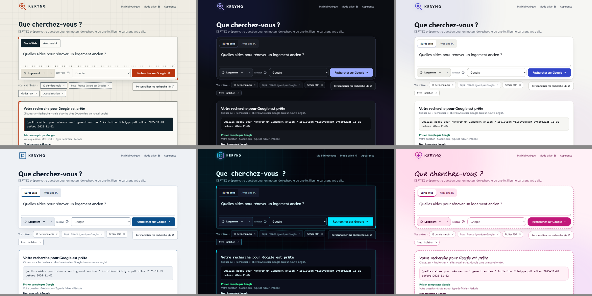
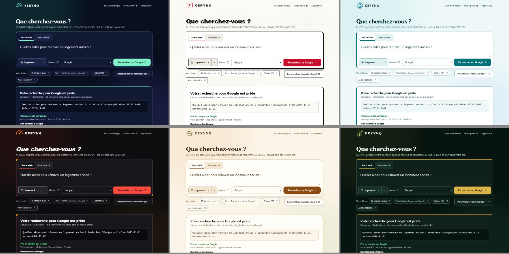

# Design system KERYNQ

Tout passe par des jetons CSS dans `assets/css/styles.css`. Un thème change des jetons, pas des composants.

## Jetons communs

| Famille | Jetons |
|---|---|
| Espacement | `--s1` 4 px, `--s2` 8, `--s3` 12, `--s4` 16, `--s5` 24, `--s6` 40 |
| Texte | `--t-xs` .75rem, `--t-sm` .8125rem, `--t-md` .9375rem, `--t-lg` 1.1875rem, `--display` pour les titres |
| Libellés | `--label-font`, `--label-case`, `--label-track` |
| Rayons | `--radius` pour les surfaces, `--radius-sm` pour les commandes |
| Couleurs | `--bg`, `--surface`, `--soft`, `--line`, `--line-strong`, `--text`, `--muted`, `--accent`, `--accent2`, `--accent-soft`, `--on-accent`, `--ok`, `--danger`, `--focus` |
| Onglet actif | `--tab-active`, `--tab-active-text` |

## Composants

- **Boutons** : `.btn` secondaire, `.btn.primary` pour une seule action par zone, `.btn.danger`, `.link-button`. Hauteur minimale 44 px.
- **États** : survol par la bordure `--accent`, focus par contour `--focus`, sélection par `--accent-soft` ou `aria-selected`, désactivé à 55 % d'opacité.
- **Champs** : `.field` et `select`, avec libellé au-dessus.
- **Surfaces** : `.composer` et `.panel`, avec contours `--edge`.
- **Panneaux** : `dialog.sheet`, latéral, plein écran sur mobile.
- **Sections repliables** : `details.fold`.
- **Critères** : `.chip`, avec `.chip-off` pour un critère ignoré par le moteur.
- **Messages** : `.status`, annoncé par `role="status"`.
- **Aperçu du texte pour l'IA** : `.prompt-preview`, couleurs `--accent`, `--text` et `--muted` du thème actif.
- **Icônes** : SVG uniquement, teintés par `currentColor`.
- **Mouvement** : moins de 200 ms, coupé par `prefers-reduced-motion`.

## Contours

| Jeton | Rôle |
|---|---|
| `--edge-w`, `--edge-s`, `--edge-c` | Épaisseur, style et couleur |
| `--edge-top`, `--edge-top-w` | Bord supérieur |
| `--edge-left`, `--edge-left-w` | Bord gauche |
| `--edge-tick`, `--edge-tick-c` | Repères d'angle, 0 pour aucun |
| `--edge-shape` | Forme des angles |

| Thème | Contour |
|---|---|
| Nuit | Filet légèrement teinté par l'accent |
| Clair | Bord supérieur plus marqué |
| Pro | Filet discret, bord supérieur fin de la couleur d'accent |
| Cyber | Filet précis, repères d'angle lumineux |
| Girly | Pointillés façon couture |
| Aurore | Bords supérieur et gauche aux deux couleurs du thème |
| Manga | Trait d'encre existant, angles irréguliers |
| Médecine | Filet net, bord gauche clinique |
| Tuning | Bord gauche épais, repères d'angle orange |
| Animaux | Trait doux, angles arrondis irréguliers |
| Finance | Filet structuré, bord supérieur or |

Les 11 thèmes historiques ne changent que par ces jetons. Leurs couleurs, polices et rayons sont vérifiés par les tests. L'en-tête, les onglets et la mise en page sont communs à tous les thèmes.

## Thème KERYNQ

Thème signature, par défaut pour les nouveaux utilisateurs. Idée : **la carte et l'instrument de précision**, à partir de la loupe et de l'étoile du logo.

- **Palette** : papier `#efece3`, encre `#10222c`, vermillon `#b8340f`, sarcelle `#0b6359` pour le focus et ce qui est confirmé.
- **Typographie** : titres Bahnschrift, libellés en petites capitales à chasse fixe.
- **Fond** : quadrillage de carte.
- **Surfaces** : angles nets et repères d'angle vermillon.
- **Signes distinctifs** : règle graduée entre la question et les commandes, recherche préparée en bloc d'encre, onglet actif plein.
- **Mouvement** : la flèche de l'action se déplace légèrement au survol.
- **Logo** : symbole existant de la loupe et de l'étoile, inchangé.

Le thème déjà enregistré chez un utilisateur est conservé. Un profil sans thème enregistré, antérieur à KERYNQ, garde Nuit.
