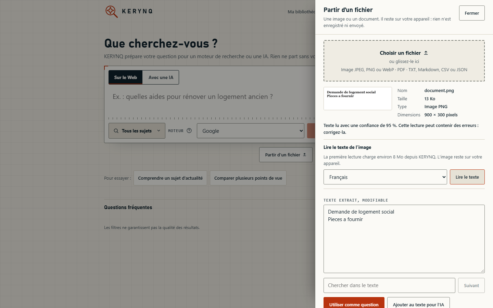
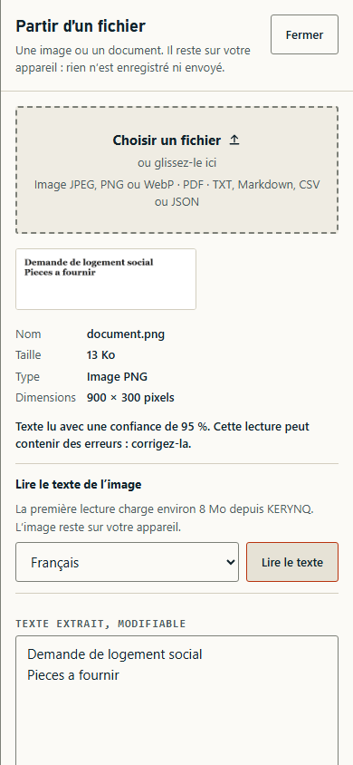

# Recherche par fichier

KERYNQ peut préparer une recherche à partir d'une image ou d'un document. Le fichier est lu **dans le navigateur** : pas de serveur, pas d'API, rien n'est envoyé sans action de l'utilisateur.

## Formats et limites

| Format | Taille maximale | Ce que fait KERYNQ |
| --- | --- | --- |
| JPEG, PNG, WebP | 15 Mo, 50 mégapixels pour l'OCR | Aperçu, dimensions, métadonnées, OCR sur demande |
| PDF | 30 Mo, 200 pages lues | Texte, titre, nombre de pages |
| TXT, Markdown, CSV, JSON | 5 Mo | Texte affiché tel quel, JSON mis en forme |

Un seul fichier à la fois, 500 000 caractères au plus. Chaque fichier est contrôlé par extension, type déclaré et signature binaire pour les images et les PDF. HTML, SVG et les autres formats sont refusés.

## Fonctionnement

1. **Lecture :** le fichier reste en mémoire dans la page.
2. **Métadonnées :** seules des informations choisies sont affichées. GPS, auteur, numéro de série et données proches sont masqués, puis affichés sur demande, et jamais repris dans une recherche.
3. **OCR :** il démarre seulement au clic. Le moteur et les langues (environ 8 Mo) viennent de KERYNQ lui-même, sans mise en cache IndexedDB. Le résultat peut contenir des erreurs : il est modifiable.
4. **Réutilisation :** « Utiliser comme question » place le passage dans la question, raccourci à 300 caractères. « Ajouter au texte pour l'IA » l'ajoute aux précisions (6 000 caractères), marqué comme une donnée et non comme des instructions. Les moteurs, IA, univers et filtres habituels s'appliquent ensuite.
5. **Recherche inversée :** Google Lens et TinEye s'ouvrent dans un nouvel onglet. L'utilisateur y importe lui-même son image : KERYNQ ne transmet rien.
6. **Effacement :** le bouton dédié arrête le traitement en cours, libère l'URL temporaire et vide les champs.

KERYNQ n'identifie ni objet, ni personne, ni lieu dans une image.

## Confidentialité

- Le fichier n'est écrit ni dans `localStorage`, ni dans `sessionStorage`, ni dans IndexedDB, ni dans le cache du service worker.
- Le texte que **vous choisissez** de réutiliser rejoint votre recherche : il est alors enregistré dans ce navigateur comme toute recherche, hors mode privé, puis envoyé au moteur ou collé dans l'IA seulement si vous le décidez.
- Les bibliothèques ne se chargent qu'à l'usage. Le service worker peut les garder en cache, car ce sont des ressources de l'application.
- Le texte importé est affiché par `value` et `textContent`, jamais comme du HTML.

## Sécurité

- **CSP :** seule modification, `blob:` dans `img-src` pour l'aperçu local. Ni `unsafe-inline`, ni `unsafe-eval`, ni domaine externe.
- **Workers :** ils se chargent depuis KERYNQ (`worker-src 'self'`). Sur GitHub Pages, un worker chargé depuis une adresse propre a sa propre politique, définie par les en-têtes de sa réponse : la CSP en balise `meta` ne s'y applique pas. C'est ce qui permet à WebAssembly de fonctionner sans `wasm-unsafe-eval` dans la page, mais ces workers ne sont donc pas soumis à cette CSP.
- **PDF :** `isEvalSupported` désactivé, polices non chargées, formulaires XFA ignorés. Les PDF protégés ne sont pas déverrouillés.

## Bibliothèques

Versions figées, copiées dans `assets/vendor/` avec leurs licences. Aucun CDN.

| Bibliothèque | Version | Licence | Fichiers |
| --- | --- | --- | --- |
| exifr (lite) | 7.1.3 | MIT | 46 Ko |
| pdf.js (pdfjs-dist) | 6.4.299 | Apache-2.0 | 1,7 Mo |
| tesseract.js | 7.0.0 | Apache-2.0 | 174 Ko |
| tesseract.js-core (SIMD, LSTM) | 6.1.2 | Apache-2.0 | 4 Mo |
| @tesseract.js-data fra et eng (4.0.0_best_int) | 1.0.0 | MIT (paquet) | 3,7 Mo |

exifr n'a pas reçu de mise à jour depuis 2022 : il ne lit ici que des images choisies par l'utilisateur, sans réseau. À surveiller. Dependabot ne suit pas ces copies : les mises à jour sont manuelles.

## Limites

- **PDF scanné :** la limite est affichée. L'OCR de PDF n'est pas inclus dans ce lot : il faudrait dessiner les pages, avec un coût mémoire à limiter.
- **Ouverture directe de `index.html` :** images et textes fonctionnent, mais PDF et OCR demandent un site hébergé selon le navigateur ; un message l'indique.
- **OCR :** demande WebAssembly SIMD (navigateurs récents). La qualité dépend de l'image. Français et anglais seulement.
- **Google Lens et TinEye :** adresses officielles. Lors du contrôle automatique, Lens renvoyait vers sa page de présentation et TinEye bloquait les robots : l'import reste à essayer à la main.
- **Lecteurs d'écran, téléphones réels et Safari réel :** non testés.

## Deuxième phase : étude de faisabilité

Non développée.

- **Vidéo :** réalisable sans bibliothèque. `<video>` et un `canvas` permettent l'aperçu et l'extraction d'une image, puis l'OCR existant et la recherche inversée manuelle. Limite : seuls les codecs du navigateur. Un `canvas` issu d'un `blob:` reste lisible. Effort faible.
- **Audio, lecture et métadonnées :** `<audio>` suffit pour la lecture, exifr ne couvre pas ces formats. Une petite bibliothèque serait nécessaire pour les balises. Effort faible.
- **Audio, transcription :** possible avec Whisper en WebAssembly, mais un modèle pèse de 40 à plus de 100 Mo, avec un calcul lent sur mobile et un hébergement à la limite du raisonnable sur GitHub Pages. À réserver à une option clairement annoncée, après un essai réel.

## Rapport de contrôle

Testé automatiquement (`tests/unit/file-core.test.cjs`, `tests/browser/files-browser-smoke.py`), dans Chromium, Firefox et WebKit sous Playwright, sur un serveur local sous `/KERYNQ/` :

- chaque format accepté, et les fichiers refusés : SVG, HTML, déguisés, trop lourds, binaires, abîmés ;
- PDF avec texte, scanné, abîmé et protégé ; OCR réel, annulation et ressources manquantes ;
- GPS et numéro de série absents de la page tant qu'ils ne sont pas demandés ;
- passage repris dans une requête Google Scholar et dans le texte pour l'IA ; texte corrigé repris tel quel ;
- aucune requête externe, aucune bibliothèque avant usage, rien de stocké hors passage choisi ; URL temporaire libérée à l'effacement ;
- profil et favoris inchangés ; 6 thèmes en 1440, 390 et 320 px sans débordement.

Ouverture directe de `index.html` : textes testés dans les trois moteurs. PDF lisible dans Firefox, refusé avec un message dans Chromium et WebKit. OCR non testé dans ce cas.

Non vérifié : Chrome, Brave et Safari réels, téléphones réels, lecteurs d'écran, véritable glisser à la souris (événement simulé), import réel sur Google Lens et TinEye, GitHub Pages lui-même, très gros fichiers et manque de mémoire.

