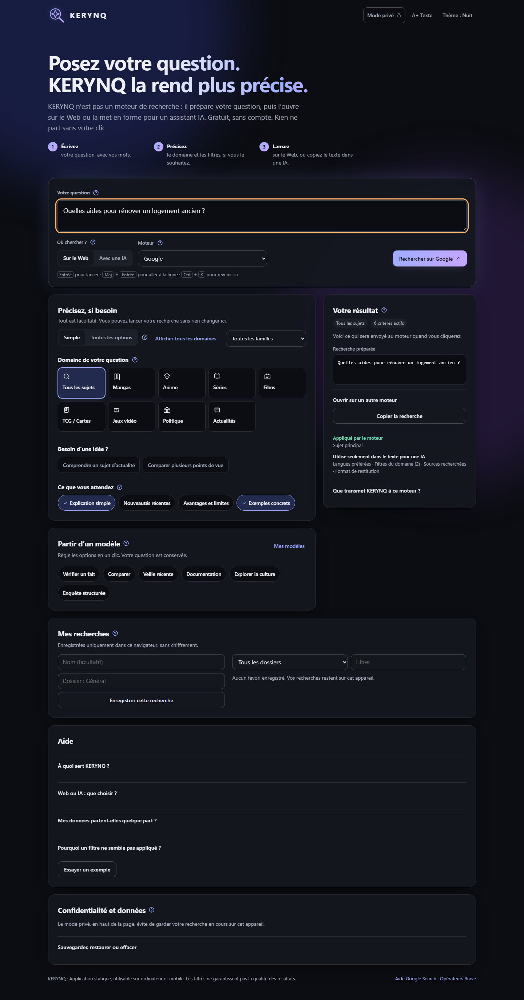
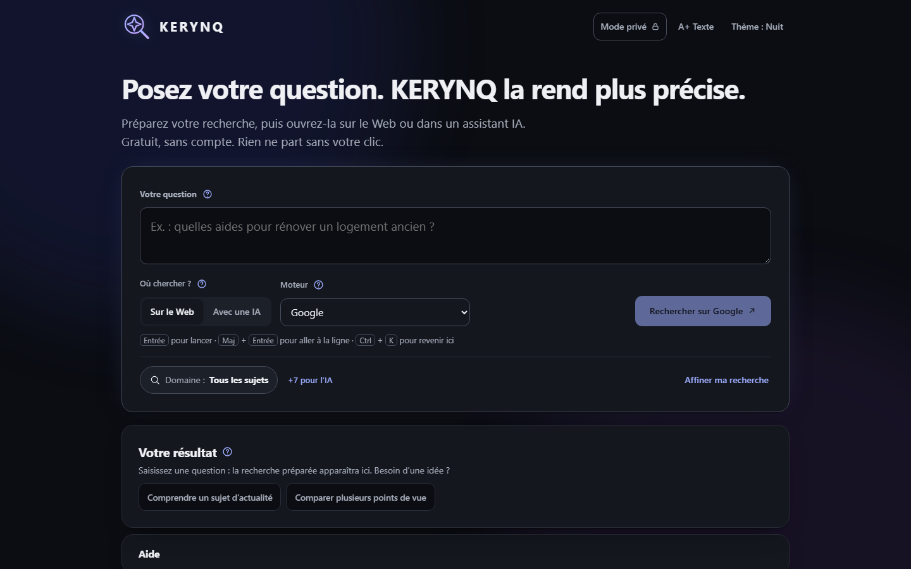
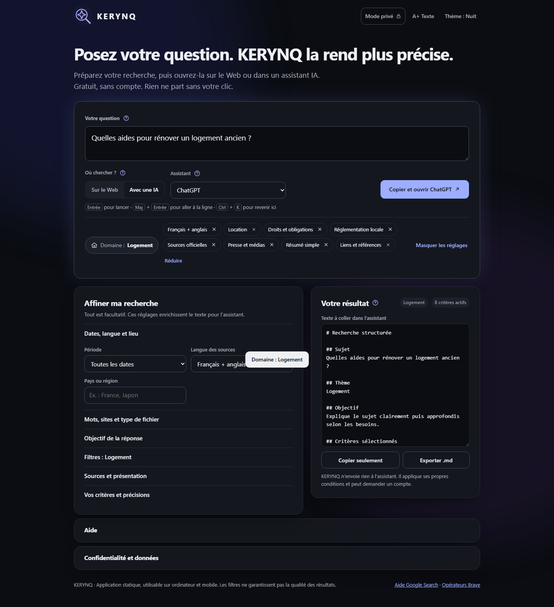
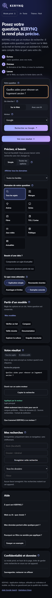
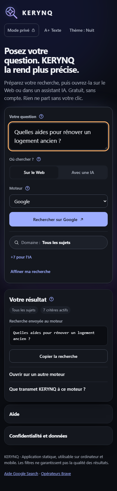

# Refonte UX de la recherche

## Problème

La page présentait en même temps les 39 domaines, la famille, les exemples, les objectifs, les filtres et un grand panneau de résultat, même sans question. Il fallait comprendre beaucoup d'éléments avant une première recherche.

## Nouvelle hiérarchie

1. **Question**, dans un seul bloc de recherche.
2. **Web ou IA**, puis le moteur ou l'assistant, dans ce même bloc.
3. **Action principale** : un seul bouton, dont le libellé nomme la destination.
4. **Contexte** : domaine, critères actifs et « Affiner ma recherche ».

Le résultat suit. Sans question, il se limite à une phrase et à deux exemples.

## Décisions

| Sujet | Décision | Raison |
|---|---|---|
| Domaines | Bouton ouvrant une liste filtrable, groupée par famille (`role="combobox"` et `role="listbox"`, modèle WAI-ARIA avec `aria-activedescendant`) | Les 39 domaines restent accessibles sans occuper la page. Une seule zone de défilement. |
| Familles | Filtrent la liste sans changer le domaine | L'ancien filtre changeait le domaine choisi par surprise. |
| Réglages | Fermés au chargement, regroupés en sections repliables | L'option apparaît seulement à la demande. L'ancienne bascule Simple / Toutes les options et les filtres rapides disparaissent. Ces derniers doublaient les filtres du domaine. |
| Web et IA | Objectif, filtres du domaine, sources, présentation, critères personnels et précisions sont réservés au mode IA | Ils ne changent pas la requête Web. Ils restent enregistrés en mode Web. |
| Critères actifs | Liste retirable, limitée à trois, puis « +N » | Le compteur inclut tous les critères actifs, même repliés. |
| Web ou IA dans le résumé | Vert : transmis au moteur choisi, d'après le compilateur. Pointillés : texte pour une IA seulement | Le classement suit le moteur choisi. La région est transmise à certains moteurs, pas à Google. |
| Bouton « Copier et ouvrir » du panneau | Retiré | Il doublait l'action principale. |
| Aide, données | Sections repliées en bas de page | Toujours accessibles, moins de concurrence visuelle. |
| Mes recherches | Retiré à la demande du propriétaire | Les favoris déjà enregistrés restent dans le navigateur et dans les sauvegardes, sans pouvoir être rechargés depuis la page. |
| Domaines récents | Non ajoutés | La liste filtrable suffit et cela alourdirait le parcours. |
| Style | Moins d'animations, de dégradés et de verre ; polices et thèmes conservés | Les couleurs d'accent marquent l'action et l'état actif. |

## Avant et après

Avant, ordinateur :

Après, ordinateur, sans question :

Après, mode IA avec réglages ouverts :

Avant, puis après, sur mobile :

## Équivalence des résultats

`tests/browser/golden-queries.json` contient les sorties de `main` avant la refonte : 4 jeux de réglages, les 23 moteurs d'alors et les consignes IA. `regressions-browser-smoke.py` les compare à la version actuelle. La date est figée pour les périodes relatives.

## Contrôles

Automatiques, sous Playwright : parcours en 1440, 768, 390 et 320 px, clavier du sélecteur, focus après sélection, retrait d'un critère, conservation des réglages, anciens profils et conservation des favoris, tous les thèmes, reflow équivalent à un zoom de 200 % et 400 %, PWA hors ligne.

Non vérifié : Safari et Chrome réels, téléphones réels, lecteurs d'écran, vrai zoom du navigateur, GitHub Pages. Ces contrôles ne valent pas conformité WCAG : aucun audit complet n'a été réalisé.

## Limites connues

- Les modèles enregistrés restent dans les sauvegardes, mais ne peuvent plus être chargés depuis l'interface, conformément au retrait demandé de « Partir d'un modèle ».
- Le choix du domaine n'est pas repris dans la requête Web, comme avant la refonte.
- Retirer un critère personnel le décoche sans le supprimer.
