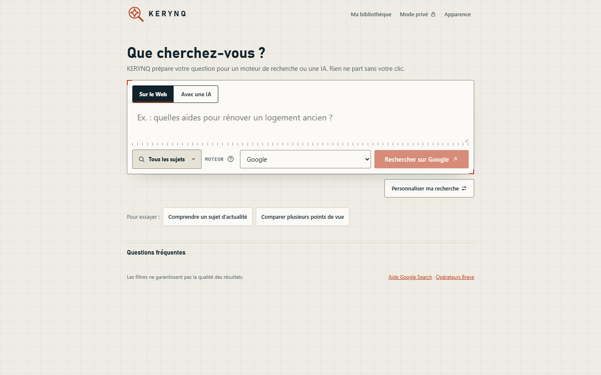
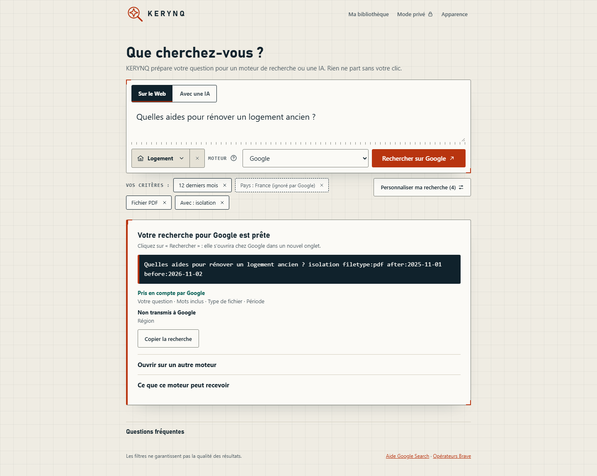
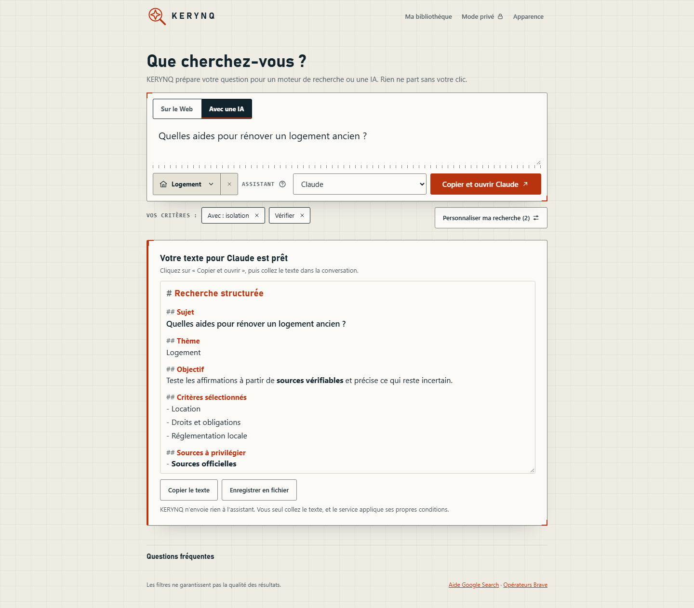
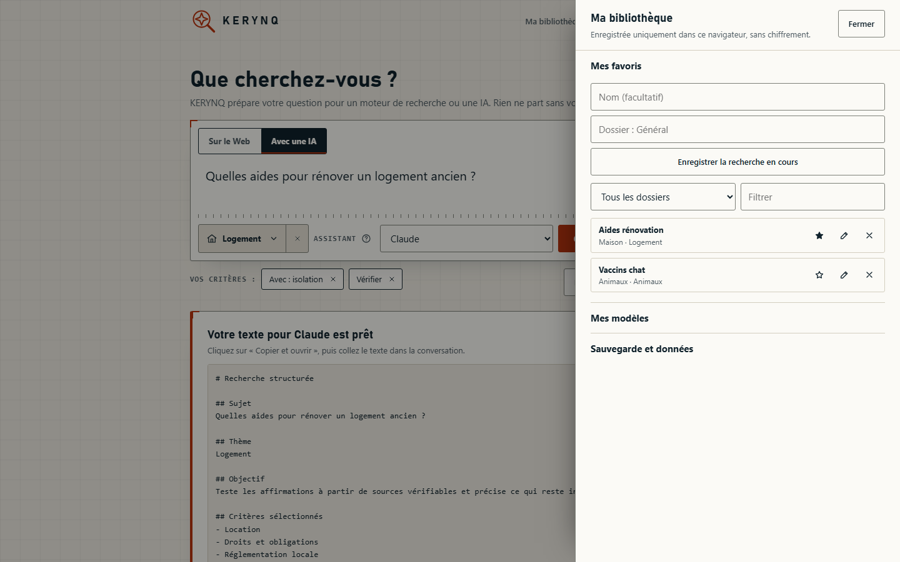

# Refonte UX de la recherche

## Problèmes relevés

Première version de la PR #19 : grand titre, bloc massif, bouton isolé, « +7 pour l'IA » incompréhensible, réglages et résultat qui se faisaient concurrence, bibliothèque supprimée.

## Organisations étudiées

1. **Deux colonnes permanentes** (réglages et résultat). Écartée : elle montre trop de choses avant la première recherche.
2. **Assistant par étapes.** Écarté : il ralentit la recherche simple.
3. **Espace de recherche unique, panneaux à la demande.** Retenue : la question d'abord, la puissance disponible sans être imposée.

## Parcours

1. **Où écrire** : le titre de la page, « Que cherchez-vous ? », est le libellé du champ.
2. **Web ou IA** : deux onglets accrochés au champ.
3. **Sujet, moteur ou assistant, action** : une seule ligne, dans le même bloc que la question.
4. **Personnaliser** : un seul bouton, qui ouvre un panneau latéral et affiche le nombre de critères choisis.
5. **Résultat** : discret sans question. Ensuite, il indique le service, le texte exact, ce qui est pris en compte ou non, et l'action suivante.

## Décisions

| Sujet | Décision | Raison |
|---|---|---|
| Critères | Seuls les choix de l'utilisateur apparaissent, jamais les valeurs par défaut | Remplace « +7 pour l'IA », qui faisait croire à des options activées. |
| Critère ignoré | « Pays : France (ignoré par Google) », en pointillés | Le classement vient du compilateur de requêtes et suit le moteur choisi. |
| Web et IA | Le panneau n'affiche que les réglages du mode en cours | Les autres réglages restent enregistrés. |
| Sujet | Liste filtrable groupée par famille, modèle combobox WAI-ARIA, croix pour revenir à « Tous les sujets » | Un sujet repris d'une ancienne session est visible et se retire en un clic. Le panneau dit à quoi sert le sujet. |
| Panneaux | Élément natif `dialog` : focus contenu, Échap, focus rendu au bouton | Pas de code de piège à focus à maintenir. |
| Bibliothèque | Dans l'en-tête : favoris, dossiers, modèles, sauvegarde et données | Tout est restauré sans encombrer l'accueil. Clés de stockage et structure inchangées. |
| Première visite | Bandeau et étapes retirés, exemples sous le champ | La page doit se comprendre sans mode d'emploi. |
| Texte agrandi | Dans le menu « Apparence » | Allège l'en-tête. |

## Avant et après

Avant, sur `main` :

Après, nouvel utilisateur :

Recherche Web préparée :

Recherche IA préparée :

Réglages :

Bibliothèque :

Mobile, avant puis après :

Thèmes : voir [DESIGN_SYSTEM.md](DESIGN_SYSTEM.md).

## Équivalence

`tests/browser/golden-queries.json` contient les sorties de `main` : 4 jeux de réglages, les 22 moteurs de l'époque encore présents et les consignes IA. `tests/browser/golden-themes.json` fige les couleurs, polices et rayons des 11 thèmes historiques. `regressions-browser-smoke.py` compare les deux à la version actuelle.

## Contrôles

Automatiques, sous Playwright : parcours Web et IA, 39 sujets, moteurs, 12 thèmes, critères, favoris, dossiers, modèles, import et export, mode privé, persistance, panneaux, clavier, aucune requête externe sans action, en 1440, 1024, 768, 390 et 320 px. Reflow équivalent à un zoom de 200 % et 400 %, PWA hors ligne, Chromium, Firefox et WebKit.

Inspection visuelle de captures, faite par l'agent : situations demandées en 1440 et 390 px, panneaux en 768 et 320 px, 12 thèmes sur planche.

Non vérifié : avis d'utilisateurs réels, Safari et Chrome réels, téléphones réels, lecteurs d'écran, vrai zoom du navigateur, GitHub Pages. Ces contrôles ne valent ni validation UX humaine ni conformité WCAG.

## Limites connues

- Le contraste testé porte sur les couleurs de base de chaque thème, pas sur chaque composant.
- La police du thème KERYNQ (Bahnschrift) dépend de l'appareil, avec une police de repli.
- Retirer un critère personnel le décoche sans le supprimer.
- Un profil enregistré avec un nom de thème inconnu passe au thème KERYNQ.

## Aperçu du texte pour l'IA

Le texte est affiché en HTML structuré : titres de section à la couleur d'accent du thème, libellés en gras, listes espacées, quelques mots-clés renforcés. La chaîne de `buildPrompt()` reste la seule source : la copie et l'export la reprennent telle quelle, sans HTML. `KerynqPrompt.structure` découpe les lignes, et l'affichage passe uniquement par `textContent` et des nœuds de texte. Les marques Markdown restent visibles en discret. Seuls les titres de section connus sont stylés comme des titres : la question de l'utilisateur reste du texte simple.
